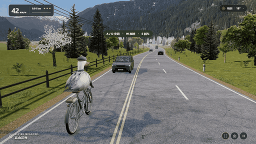
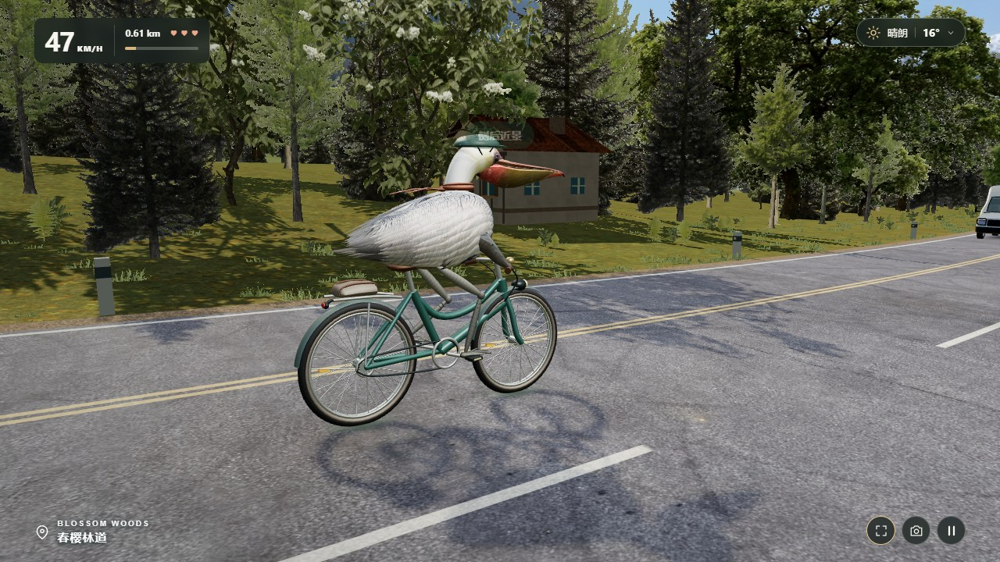
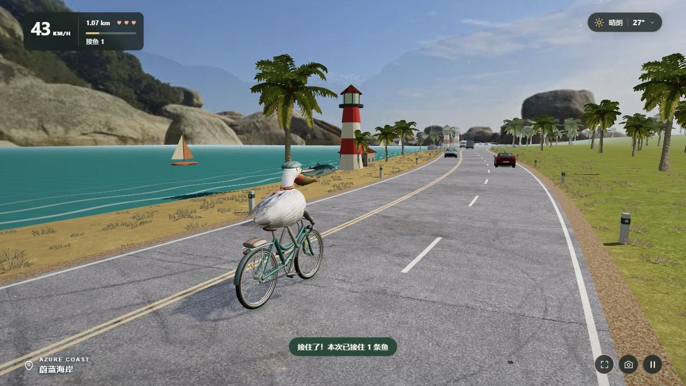
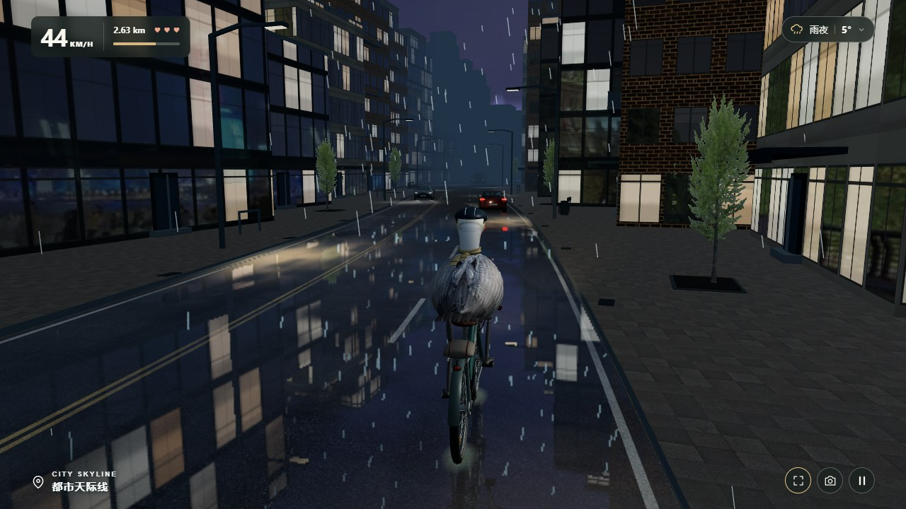
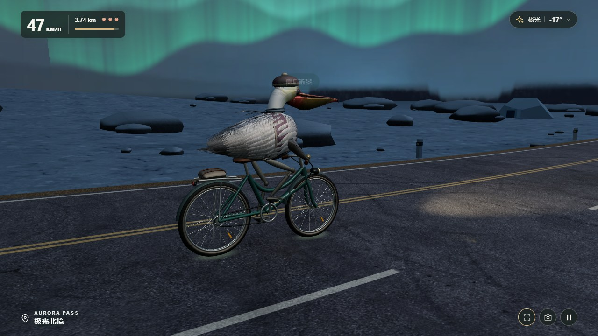

# PeliRide · 鹈鹕骑行社

一只鹈鹕，一辆单车，一条从春天骑到冬天的 **4.16 公里公路**。从高山花甸出发，在海岸接一条跃出水面的鱼，穿过雨夜里的车流，最后骑到极光下。全程八段风景，打开浏览器就能玩。

**[在线开始骑行](https://deaglepc.github.io/peliride-four-seasons/)**　·　[下载项目 ZIP（含离线版）](https://github.com/DeaglePC/peliride-four-seasons/archive/refs/heads/main.zip)　·　[作者的 X](https://x.com/deaglepc)

## 实机演示



上面这次翻车发生在高山花甸。看左上角的速度和体力，再看单车与鹈鹕分别落在了哪里。完整录屏还拍到了海岸接鱼、都市雨夜和雪地极光。[下载约 17 秒的 720p 实机录像（MP4，无声）](https://github.com/DeaglePC/peliride-four-seasons/raw/refs/heads/main/docs/media/four-seasons-ride.mp4?download=1)

## 骑过四季

| 春日 · 高山花甸 → 春樱林道 | 盛夏 · 蔚蓝海岸 → 金色沙海 |
| :--- | :--- |
| [](docs/media/spring-woods.jpg) | [](docs/media/summer-catch.jpg) |
| **金秋 · 枫林山谷 → 都市天际线** | **凛冬 · 雪峰垭口 → 极光北境** |
| [](docs/media/city-rain.jpg) | [](docs/media/aurora-pass.jpg) |

## 第一趟怎么玩

- **先试变道。** 点「开始骑行」后单车会自动前进。观察前方车流，提前减速或变道。每次撞车扣一格体力，撞前骑得越快，鹈鹕被甩得越远。还有体力就会扶车继续。
- **想接鱼就从盛夏出发。** 首页点「盛夏」，再开始骑行。左侧海面冒出水花时，看速度表旁的车道提示，把车骑到鱼的飞行路线上。鱼经过喙边时，鹈鹕会自己张嘴。
- **想看极光就用路书。** 在「路线图」里跳到「极光北境」，点右上角的天气按钮可以直接选「极光」。也可以让天气随路线变化，沿途遇见风、雨和雪。
- **出发前可以换装。** 「骑行衣橱」里有海岸骑手、高山旅人、夜航骑士三套装备。骑行结束后能看到里程、避开的车辆、近距闪避和接鱼数。

### 操作

| 动作 | 键盘 |
| --- | --- |
| 左右变道 | **A / D** 或 **← / →** |
| 加速 / 刹车 | 按住 **W / S** 或 **↑ / ↓** |
| 切换第三人称机位 | **C** |
| 进入或退出沉浸模式 | **F** |
| 打开路书 / 按车铃 | **M / B** |
| 暂停 / 继续 | **空格** |

手机横竖屏都能玩。用画面下方的触控按钮变道、加速和刹车，点相机图标切换机位。

## 离线游玩与本地开发

下载并解压上方的项目 ZIP，用支持 WebGL 2 的浏览器打开 `dist/index.html` 即可骑行。模型、纹理和游戏代码都在这一个文件里。

修改游戏后，在仓库根目录用 Node.js 22 和 npm 重新构建。

```sh
npm ci
npm run build
```

构建结果是 `dist/index.html`。`game.js` 负责输入和骑行状态，`world.js` 组织 Three.js 场景，`models/` 包含骑手、车流、接鱼和翻滚动作。推送到 `main` 后，GitHub Actions 会重新构建并发布到 Pages。

游戏内「操作指南 → 摄影、模型与材质来源」收录了素材署名，也可以直接查看[全景摄影](assets/panorama/credits.txt)、[植被和地表](assets/nature/credits.txt)、[骑手材质](assets/rider/CREDITS.txt)与[车辆模型](assets/traffic/credits.txt)的来源。
